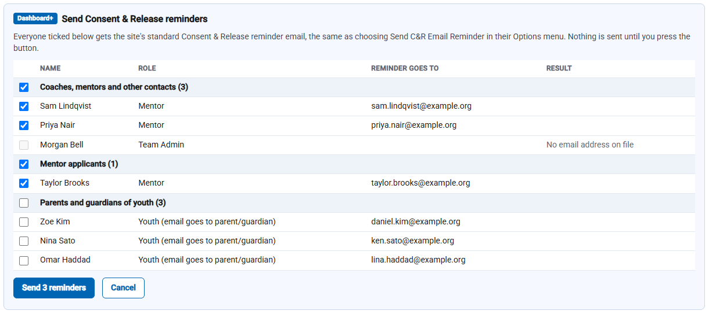

# FIRST Dashboard+

The FIRST Dashboard (`my.firstinspires.org/Dashboard`) tells coaches *that* something is wrong — a red
"Outstanding Task(s)" badge, a "Pending Roster Task" — but rarely *what*, and roster chores like approving applicants or
chasing Consent & Release forms are one person, one menu, one click at a time.

Dashboard+ is a small Chrome extension that fixes that. It runs entirely in your browser, in your own signed-in
session: it uses the data the page already has, sends nothing anywhere except `my.firstinspires.org`, and never acts
without a click.

## What it does

### See what every task actually is

Each team's badges become one count, and underneath sits one plain-English line per cause, what it is holding up, and
a **Fix** button that opens the exact page where it gets fixed.

The site's own text for these is often a raw key (`val.team_contacts:1`) or nothing at all. Dashboard+ also shows an
"Opening the page…" message while a Fix page loads, instead of the site's blank screen.

### Jump between personas from the sidebar

**Team**, **Event Volunteer**, **Parent/Guardian** and **Class Pack** get their own sidebar buttons (visible in the
screenshot above), so there is no Switch Persona round-trip. Personas with nothing in them are tucked under
**More…**.

### Roster at a glance

On a team's **Team Roster** tab, a summary shows who is waiting for a decision and who is missing Consent & Release,
screening or training — without scrolling through every person.

### Bulk accept and bulk C&R reminders

**Accept applicants…** and **Send C&R reminders…** list everyone affected with a tick box. Nothing happens until you
press the button; then requests go out one at a time, each row shows its result, and a run can be stopped part-way.
Reminders go to coaches and mentors by default; parents of youth are listed but left unticked, and anyone without an
email on file is shown and skipped.

Both use the site's own actions — the same as choosing Approve Membership or Send C&R Email Reminder in each person's
Options menu.

### Layout fixes

- Checkboxes in **Communication & Mentoring** (and similar sections) sit beside their labels, not above them.
- The team list's **Participating Team** column no longer runs off the edge at narrow widths.
- The task tooltip over the first team tab is no longer cut off.
- The older roster wizard no longer draws its "Create New Team" header and step bar twice.

## Install

1. Download or clone this repo.
2. Open `chrome://extensions` and turn on **Developer mode** (top right).
3. **Load unpacked** → choose the `dashboard-plus` folder.
4. Reload the Dashboard.

To update, replace the files, press the reload arrow on the extension's card, and reload the Dashboard.

## Good to know

- **Big rosters are slow.** FIRST's server can take about a minute to produce a large team's roster. Dashboard+ never
  asks for it again on its own, but can't make that first load faster.
- **Not tested end to end yet:** accepting a real applicant and sending reminders from the panel (both were dry-run
  with intercepted requests; the reminder request itself was sent once by hand and succeeded), and the panel on a
  large roster.
- **Deliberately left alone:** inviting people (the site puts a reCAPTCHA on it) and the Mentor Network, whose terms
  forbid automated use.
- The screenshots use made-up teams and people.

`FINDINGS.md` has the details behind all of this: how the Dashboard is put together, the server calls it makes, what
each task key means, and the site bugs found along the way.
