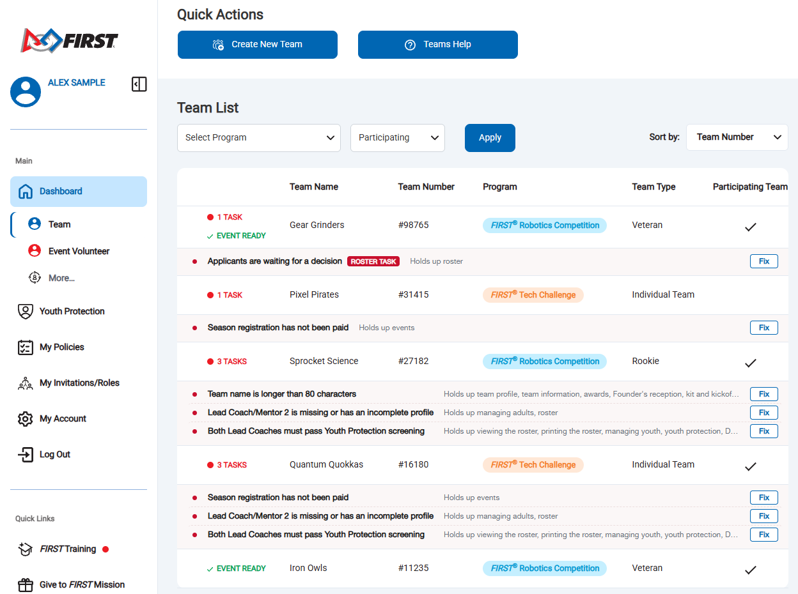
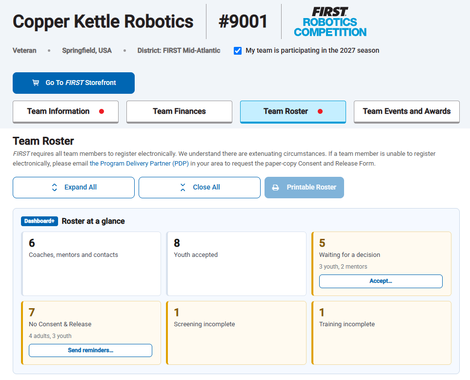

# FIRST Dashboard+

The FIRST Dashboard (`my.firstinspires.org/Dashboard`) tells coaches *that* something is wrong — a red
"Outstanding Task(s)" badge, a "Pending Roster Task" — but rarely *what*, and roster chores like approving applicants or
chasing Consent & Release forms are one person, one menu, one click at a time.

Dashboard+ is a small Chrome extension that fixes that. It runs entirely in your browser, in your own signed-in
session: it uses the data the page already has, sends nothing anywhere except `my.firstinspires.org`, and never acts
without a click.

## What it does

### See what every task actually is

Each team's badges become one count, and underneath sits one plain-English line per cause, what it is holding up, and
a **Fix** button that opens the page where it gets fixed (clicking anywhere on the line does the same). Roster tasks open
the team's **Team Roster** tab, a missing school opens Team Information at the School/Organization card, and unpaid
registration opens Team Finances, instead of the site's links to its old "Create New Team" wizard pages.

The site's own text for these is often a raw key (`val.team_contacts:1`) or nothing at all. Dashboard+ also shows an
"Opening the page…" message while a Fix page loads, instead of the site's blank screen.

### Know when the site is still working

A large team's roster takes FIRST over a minute to send, and until now the **Team Roster** tab just sat blank. Dashboard+
shows "Loading the roster…" with a seconds counter until it arrives. It also warns that the page may stop responding
for a while afterwards, while the site looks up everyone's screening. The same message appears for any other section
of a team page that takes more than a moment to load.

### Payment History without the Search button

On **Team Finances**, Payment History now loads by itself when you open the tab, and picking another season loads it
straight away. FIRST's own Search froze the whole page for 8–11 seconds; Dashboard+ runs the same request in the
background with a "Loading payment history…" message instead of the site's "$0.00 / not available" placeholder.
Seasons you've already looked at come back instantly.

### Jump between personas from the sidebar

**Team**, **Event Volunteer**, **Parent/Guardian** and **Class Pack** get their own sidebar buttons (visible in the
screenshot above), so there is no Switch Persona round-trip. Personas with nothing in them are tucked under
**More…**.

### Roster at a glance

On a team's **Team Roster** tab, a summary shows who is waiting for a decision and who is missing Consent & Release,
screening or training — without scrolling through every person.

### Bulk accept and bulk C&R reminders

**Accept applicants…** and **Send C&R reminders…** list everyone affected with a tick box. Nothing happens until you
press the button; then requests go out one at a time, each row shows its result, and a run can be stopped part-way.
Reminders go to coaches and mentors by default; parents of youth are listed but left unticked, and anyone without an
email on file is shown and skipped.

Both use the site's own actions — the same as choosing Approve Membership or Send C&R Email Reminder in each person's
Options menu.

### Layout fixes

**Team pages**
- **Tighter header:** the area from "Return to Dashboard" to the four tabs is about a third shorter. The team details,
  Event Ready badge and "My team is participating" share one line, the Storefront button lines up with the team name,
  and the tabs, Storefront button and each tab's content all end at the same right edge. FIRST's red task tooltip
  above the active tab gets room of its own instead of covering the line above.
- Each tab's content lines up with the team name and tabs above it, instead of sitting 15px to the left.
- **Shorter roster cards:** each person's Consent & Release, screening and training lines move under their name, and
  the "Include In Team Roster Printout" / award submitter check boxes move into the empty space beside the
  parent/guardian details. Cards are about a quarter shorter, so a large roster takes far less scrolling.
- **One scroll area:** an open team page fills the window below the header and the footer is hidden, so only the team
  page scrolls. Before, the Dashboard around it scrolled too, and the site's pop-ups (Invite, Send C&R reminder…)
  could end up hidden under the header.
- The **Team Roster** tab fills the page width like the other tabs, and its Expand All row lines up with the heading.
- Drop-downs (Country, Region, Sponsor type…) match the text boxes beside them in font, inset and border.
- On the roster, parent/guardian names use the same font as every other name (the site styled them as larger grey labels).
- Checkboxes in **Communication & Mentoring** (and similar sections) sit beside their labels, not above them.
- "My team is participating" and its **Secured for this season** badge sit on one line.
- **Sponsors** and **School/Organization**: the "Sponsor 1" heading column is narrow, so the fields get the width (it took a third of the card).
- The three mentoring checklists ("willing to mentor", "areas", "need mentoring in") are spaced the same.
- A lone sponsor no longer shows a "swap down" arrow with nothing to swap with.
- The task tooltip over the first team tab is no longer cut off.
- The older roster wizard no longer draws its "Create New Team" header and step bar twice.

**Elsewhere**
- The team list's **Participating Team** column no longer runs off the edge at narrow widths.
- **My Profile**: the second column of fields lines up all the way down the form.
- **My Invitations/Roles** lines up with the other Profile tabs instead of jumping sideways.
- **Volunteer Information**: the diet restriction buttons sit on an even grid instead of a ragged patchwork.
- The sidebar persona marker clears when you're on Youth Protection, My Account and other non-dashboard pages.

### Switch it off and on

Click the Dashboard+ icon (the FIRST triangle-circle-square mark) in Chrome's toolbar to turn everything off and see the Dashboard exactly as
FIRST draws it; click again to turn it back on. No reload needed, and an **OFF** badge shows while it's off. A bulk
accept or reminder run that has already started finishes before the panel goes away.

## Install

1. Download or clone this repo.
2. Open `chrome://extensions` and turn on **Developer mode** (top right).
3. **Load unpacked** → choose the `dashboard-plus` folder.
4. Pin the Dashboard+ icon (the FIRST mark) from the puzzle-piece menu so the on/off button stays on the toolbar.
5. Reload the Dashboard.

To update, replace the files, press the reload arrow on the extension's card, and reload the Dashboard. The only
permission it asks for is storage, to remember whether it's switched on.

## Good to know

- **Big rosters are slow.** FIRST's server can take about a minute to produce a large team's roster. Dashboard+ never
  asks for it again on its own, but can't make that first load faster.
- **Not tested end to end yet:** accepting a real applicant and sending reminders from the panel (both were dry-run
  with intercepted requests; the reminder request itself was sent once by hand and succeeded), and the panel on a
  large roster.
- **Deliberately left alone:** inviting people (the site puts a reCAPTCHA on it) and the Mentor Network, whose terms
  forbid automated use.
- The screenshots use made-up teams and people.

`FINDINGS.md` has the details behind all of this: how the Dashboard is put together, the server calls it makes, what
each task key means, and the site bugs found along the way.
